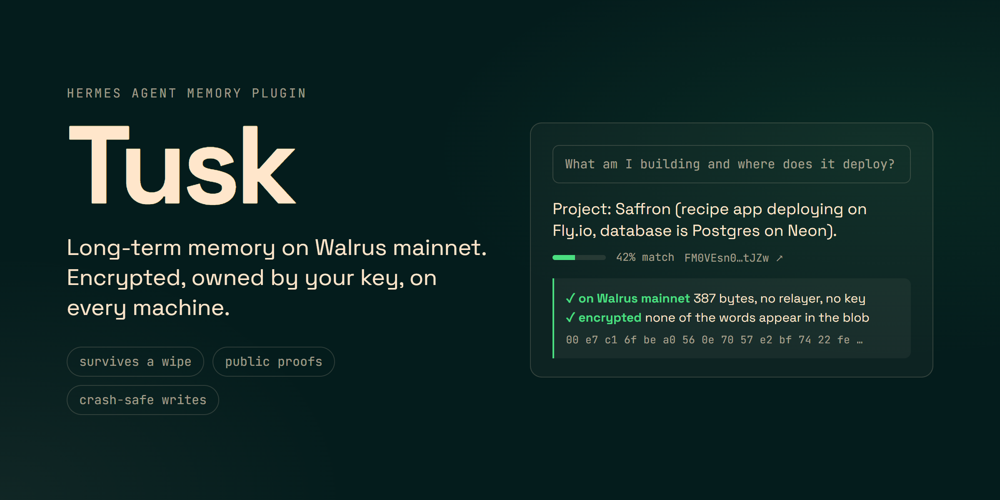
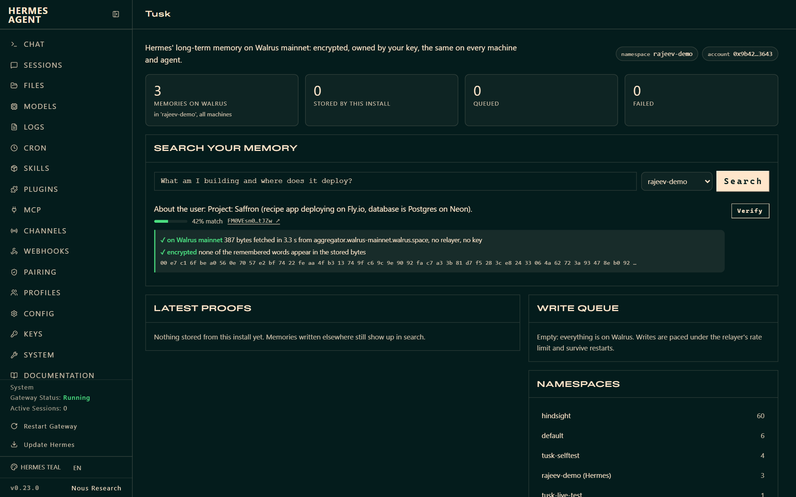

# Tusk: Hermes memory on Walrus



**Hermes' long-term memory, stored on Walrus mainnet.** It's encrypted and owned by your key. It survives a wipe or reinstall of Hermes, and it's the same on every machine and for every agent on your Walrus Memory account. Every memory has a public proof you can check yourself.

> Tusk is a community plugin built on the official Walrus Memory SDK. It is not affiliated with Mysten Labs or the Walrus Foundation.

```text
you ──► Hermes ──► Tusk ──► Walrus Memory relayer (TEE: extract, embed, SEAL-encrypt) ──► blobs on Walrus mainnet
          ▲          │ durable outbox (SQLite): paced, retried, crash-safe writes             │
          └ recall ◄─┘ receipts: blob id + Walruscan proof per memory  ◄──────────────────────┘
```

| Hermes surface | What Tusk does with it |
|---|---|
| **Memory provider** | Recalls what's relevant before every turn, distills finished turns into facts, mirrors the built-in `MEMORY.md` / `USER.md`, and saves context that's about to be compressed away |
| **Tools** | `tusk_search` (results carry proof links, any namespace), `tusk_remember`, `tusk_namespaces`, `tusk_status` |
| **Slash command** | `/tusk` status, proofs, recall, verify, retry |
| **CLI** | `hermes tusk status · recall · proofs · verify · namespaces · import · flush · export · restore · retry` |
| **Dashboard tab** | A **Tusk** page in `hermes dashboard` with live stats, semantic search across namespaces, the latest proofs, one-click on-chain verification, and the live write queue |



## Why another memory provider?

Other memory backends keep your agent's memory in one vendor's database or on one machine's disk. Tusk keeps it with you:

- **Yours.** The Walrus Memory relayer extracts facts, embeds them and encrypts them with SEAL inside a TEE, then stores each one as a Walrus blob owned by your account. Tusk only signs requests with your delegate key. Nothing in this plugin or its storage path can read your memories without that key.
- **Portable.** Wipe `~/.hermes`, reinstall, or start Hermes on another computer: add the same key and Hermes already knows you. Other agents on the same account keep their own namespaces, and `tusk_search` can look into them.
- **Verifiable.** Every stored memory gets a receipt with its blob id. `hermes tusk verify` and the dashboard's **Verify** button download the blob from a public Walrus aggregator, with no relayer and no key, and confirm the stored bytes are ciphertext.
- **Reliable.** Writes are committed to a local outbox first. A background writer sends them under the relayer's rate limit, with idempotency keys, Retry-After handling and exponential backoff. A crash, a closed terminal or a flaky network only delays a write; nothing is dropped.
- **Rebuildable.** `hermes tusk restore` asks the relayer to rebuild a namespace's search index from the blobs on Walrus.

## Quick start

1. **Credentials.** Sign in at [memory.walrus.xyz](https://memory.walrus.xyz), create a delegate key, and copy its **private key** and your **account id**.
2. **Install**
   ```bash
   hermes plugins install tusk                                  # from the plugin catalog
   hermes plugins install Automationbot24x7/hermes-tusk/tusk    # or straight from GitHub
   ```
3. **Configure.** Run `hermes memory setup`, pick **tusk**, and paste the key and account id (they go to your profile's `.env`). Or set them yourself:
   ```bash
   MEMWAL_PRIVATE_KEY=...      # delegate private key (hex)
   MEMWAL_ACCOUNT_ID=0x...     # account id
   MEMWAL_NAMESPACE=default    # optional
   ```
   then run `hermes config set memory.provider tusk`.
4. **Dashboard tab** (optional): `hermes plugins enable tusk`, then open **Tusk** in `hermes dashboard`.
5. **Check:** `hermes tusk status`

Already have memories in Hermes? `hermes tusk import` copies your built-in `MEMORY.md` and `USER.md` entries to Walrus.

Updating: after `hermes plugins update tusk`, run `hermes gateway restart` so agents that are already running load the new version.

## Using it

Just talk to Hermes. Before each turn, Tusk recalls what's relevant into a `<tusk-memory>` block, each line tagged with a short proof id. After the turn, it queues the exchange for fact extraction. Anything saved with Hermes' built-in memory tool is mirrored to Walrus.

```text
/tusk                       status, latest proofs
/tusk proofs 10             last 10 memories with Walruscan links
/tusk recall editor         semantic search across all your machines
/tusk verify 3              download the last 3 blobs from Walrus and check they are encrypted
/tusk retry                 re-queue writes that failed
```

`/tusk` is registered when the memory provider starts with the session's agent, so it's available once a chat has started. The `hermes tusk` commands work anytime:

```text
hermes tusk status          account, namespace, memories on Walrus, queue, proofs
hermes tusk recall <query>  semantic search with relevance and proof links (--namespace to look elsewhere)
hermes tusk proofs          latest memories this install stored
hermes tusk verify          check blobs on a public aggregator (--aggregator for another one)
hermes tusk namespaces      namespaces on your account and their sizes
hermes tusk import          copy built-in MEMORY.md / USER.md entries to Walrus
hermes tusk flush           send everything still queued, now
hermes tusk export          every stored memory with its blob id and proof link (--format md|jsonl)
hermes tusk restore         rebuild the namespace index from its blobs on Walrus
hermes tusk retry           re-queue failed writes
```

## Configuration

Credentials come only from Hermes (`hermes memory setup`, the profile `.env`, or a secret source), read through Hermes' profile-aware secret scope. Options live in `$HERMES_HOME/tusk/config.json` (or `$HERMES_HOME/tusk.json`):

| Key | Default | Meaning |
|---|---|---|
| `namespace` | `default` | Namespace Hermes reads and writes. `MEMWAL_NAMESPACE` overrides |
| `server_url` | `https://relayer.memory.walrus.xyz` | Relayer. `MEMWAL_SERVER_URL` overrides |
| `capture_turns` | `true` | Distill every finished turn into facts. Set `false` to keep only explicit and mirrored memories |
| `recall_limit` | `6` | Memories injected per turn (1-20) |
| `max_distance` | `0.8` | Recall cutoff. Lower is stricter |
| `prefetch_timeout_s` | `2.5` | Longest a turn waits for live recall before using the recall warmed after the previous turn |

## How it stays reliable and private

- **Durable outbox.** Writes are committed to `$HERMES_HOME/plugin-data/tusk/outbox.db` (SQLite in WAL mode, created `0600`). Jobs are claimed under `BEGIN IMMEDIATE`, so a running Hermes and `hermes tusk flush` never send the same job. Each fact carries an idempotency key.
- **Pacing and retries.** Writes go out about one every 11 s, under the relayer's per-key limit. A 429 response waits for `Retry-After`. Other errors back off exponentially, and after 6 attempts a write is parked as failed, never dropped.
- **No duplicates.** The same content isn't re-sent within 30 days. Turns where facts were saved explicitly aren't re-extracted, because the relayer doesn't deduplicate extracted facts.
- **Never blocks a turn.** `sync_turn` is a single insert. Live recall waits at most `prefetch_timeout_s`, and a late answer still lands in the cache for the next call.
- **Secrets stay local.** API keys, tokens, JWTs, private keys and `password: …` values are redacted before anything is queued. Public `0x…` addresses are kept. Sent conversation text is erased from the outbox.
- **Prompt-injection guard.** Recalled text is treated as data. It can't close or forge the `<tusk-memory>` block, and the model is told never to follow instructions inside it.
- **Right agent, right profile.** Only the primary agent writes; subagents, cron runs and flush forks only read. State is bound to the profile's `hermes_home`, and background threads use `spawn_context_thread`.

## Disclosure

- **Network:**
  - HTTPS to `relayer.memory.walrus.xyz` (or `MEMWAL_SERVER_URL`), signed with your delegate key. It carries each turn's user message (as the recall query), finished turns for fact extraction (user and assistant text, about 2,400 characters each at most), built-in memory entries, and `tusk_remember` facts.
  - `verify` and the dashboard's **Verify** button download blobs from `aggregator.walrus-mainnet.walrus.space`.
  - Walruscan links are only shown, never fetched.
- **Local data:** `$HERMES_HOME/plugin-data/tusk/outbox.db` holds queued writes (until sent) and receipts (memory text plus blob id). Options live in `$HERMES_HOME/tusk/config.json`.
- **Processes:** one in-process background writer thread. No shell commands, subprocesses or telemetry. The dashboard routes sit behind Hermes' dashboard authentication.
- **Credentials:** read only through Hermes' secret scope. The plugin never reads credential files and never writes your key anywhere.
- **Cost:** storage and extraction count against your Walrus Memory account.

## Known limits

- The relayer has no per-memory delete yet (only whole-namespace erasure), so removing an entry from Hermes' built-in memory doesn't delete its Walrus copy.
- Writes take roughly 20-30 s each and are paced. One-shot runs (`hermes chat -q`) usually exit before the queue drains. The writes stay queued and go out on the next run, or now with `hermes tusk flush`.

## Development

```bash
pip install "memwal>=0.2.2,<0.3" pytest pyyaml fastapi httpx ruff
pytest                                     # unit tests (the SDK's in-process mock stands in for the relayer)
PYTHONPATH=~/.hermes/hermes-agent pytest   # plus Hermes' real MemoryManager and the dashboard API
TUSK_LIVE=1 MEMWAL_PRIVATE_KEY=... MEMWAL_ACCOUNT_ID=... pytest tests/test_live.py   # mainnet round trip
ruff check tusk tests && ruff format --check tusk tests
hermes plugins validate ./tusk --install-deps
```

The plugin lives in [`tusk/`](.) and the tests are in [`tests/`](../tests).

## License

MIT
